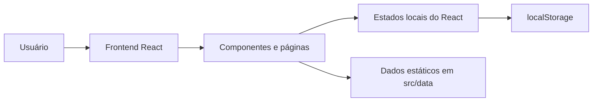
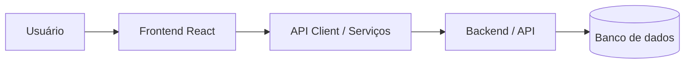

# README Técnico — Sistema ACS

## 1. Visão geral

Este repositório contém a implementação atual de um frontend em React para a plataforma ACS. O sistema foi desenvolvido para oferecer uma experiência de aprendizagem em temas como LGPD, letramento digital, segurança da informação e saúde digital.

A análise do código indica que o projeto está em desenvolvimento e que a maior parte da implementação atual está concentrada em interface, navegação e lógica local de quiz. Não há confirmação de API/backend integrada, autenticação real, banco de dados ou persistência centralizada.

## 2. Estado atual do projeto

| Funcionalidade | Estado | Observação |
|---|---|---|
| Interface principal | Implementado | Estrutura visual em React + CSS |
| Navegação | Implementado | Rotas definidas com react-router-dom |
| Login | Parcial | Tela visual e lógica local de formulário; sem autenticação real |
| Quiz interativo | Implementado | Perguntas e respostas locais em arquivos JS |
| Progresso do usuário | Implementado | Salvo em localStorage |
| Biblioteca | Parcial | Página informativa e de orientação; conteúdo não estruturado como repositório funcional |
| Cadastro | Pendente | Existem referências visuais, mas sem fluxo funcional |
| Recuperação de senha | Pendente | Link presente sem rota correspondente |
| Reset de senha | Pendente | Não identificado no código |
| API/backend | Pendente | Não há integração implementada |
| Banco de dados | Pendente | Não há persistência remota |
| Autenticação | Pendente | Não há contexto, token, sessão ou guardas de rota |

## 3. Stack tecnológica

### 3.1 Tecnologias realmente presentes

- JavaScript
- React 19
- Vite 8
- React Router DOM
- HTML5
- CSS3
- LocalStorage do navegador

### 3.2 Finalidade por tecnologia

- React: construção da interface e do comportamento reativo.
- Vite: tooling de desenvolvimento e build do projeto.
- React Router DOM: navegação entre páginas e layouts.
- JavaScript: lógica da aplicação, manipulação de estados e dados.
- CSS: estilização visual do sistema.
- LocalStorage: persistência local do histórico dos quizzes.

### 3.3 Observações sobre a stack

Não foi identificado uso de bibliotecas de UI, formulários, validação de formulário, state management global, animação ou backend. O projeto depende fortemente de dados estáticos em arquivos JavaScript.

## 4. Arquitetura atual

### 4.1 Arquitetura real do código atual



### 4.2 Arquitetura futura planejada



> A segunda arquitetura representa o futuro planejado do sistema, não a implementação atual.

## 5. Estrutura de diretórios

```text
src/
  App.jsx
  index.css
  main.jsx
  assets/
    css/
      auth_css/
      components_css/
      pages_css/
    icons/
  components/
    cards-Inicio.jsx
    header.jsx
    historico-quiz.jsx
    quiz-item.jsx
    sidebar.jsx
  data/
    perguntas.js
    quizzes.js
  layouts/
    PainelLayout.jsx
  pages/
    Auth/
      login.jsx
    Home/
      biblioteca.jsx
      home.jsx
      progresso.jsx
      quiz.jsx
  utils/
    progresso.js
```

## 6. Arquitetura de navegação

### 6.1 Rotas definidas

| Rota | Página | Componente | Finalidade | Status |
|---|---|---|---|---|
| /login | Login | src/pages/Auth/login.jsx | tela de acesso | Parcial |
| / | Home | src/pages/Home/home.jsx | painel inicial | Implementado |
| /quiz | Seleção de quiz | src/pages/Home/quiz.jsx | lista de temas | Implementado |
| /quiz/:id | Quiz | src/pages/Home/quiz.jsx | execução do questionário | Implementado |
| /biblioteca | Biblioteca | src/pages/Home/biblioteca.jsx | materiais e orientação | Parcial |
| /progresso | Progresso | src/pages/Home/progresso.jsx | acompanhamento | Implementado |
| * | Redirecionamento | src/App.jsx | fallback para / | Implementado |

### 6.2 Observações

- O sistema usa `BrowserRouter` em `src/main.jsx`.
- O layout principal é definido em `src/layouts/PainelLayout.jsx`.
- Há links navegáveis para `/perfil` e `/esqueci-senha` em componentes visuais, mas essas rotas não existem no `Routes` atual.
- O menu lateral tem `NavLink` para `/painel`, mas a configuração real do `Routes` usa `/` como base do painel. Isso indica que o sistema de navegação ainda precisa refinamento.

## 7. Páginas e componentes principais

### 7.1 App

Arquivo: `src/App.jsx`

Responsabilidade:
- registrar as rotas da aplicação;
- renderizar o layout do painel para páginas internas;
- redirecionar rotas desconhecidas para `/`.

Fluxo:
- `/login` renderiza Login.
- `/` renderiza `PainelLayout` com `Home` por padrão.
- `/quiz` e `/quiz/:id` renderizam a lógica do quiz.
- `/biblioteca` e `/progresso` renderizam as páginas correspondentes.

### 7.2 PainelLayout

Arquivo: `src/layouts/PainelLayout.jsx`

Responsabilidade:
- estruturar o painel principal com `Sidebar`, `Header` e área de conteúdo.

Elementos:
- `Sidebar`: navegação lateral.
- `Header`: área de boas-vindas e perfil.
- `Outlet`: renderiza a página ativa do React Router.

### 7.3 Sidebar

Arquivo: `src/components/sidebar.jsx`

Responsabilidade:
- navegação lateral entre Home, Quiz, Biblioteca e Progresso.

Estados:
- `collapsed`: controla a abertura/fechamento do sidebar.

Hooks:
- `useState` para alternar o estado do menu.

Observações:
- há links para páginas que existem, mas também há referência a `/painel`, que não foi configurado como rota real.

### 7.4 Header

Arquivo: `src/components/header.jsx`

Responsabilidade:
- exibir nome do usuário, avatar inicial e menu de perfil.

Estados:
- `aberto`: controla a abertura do dropdown do perfil.

Hooks:
- `useState`: botão do menu.
- `useRef`: referência do container do perfil.
- `useEffect`: escuta cliques fora do menu e tecla `Escape` para fechar.

Ações:
- `handleSair()`: fecha o menu e redireciona para `/login` usando `window.location.href`.

Observações:
- não há autenticação verdadeira; o sair apenas troca a URL.
- o link "Perfil" aponta para `/perfil`, mas essa rota não existe.

### 7.5 Home

Arquivo: `src/pages/Home/home.jsx`

Responsabilidade:
- composição da página inicial.

Componentes filhos:
- `CardsInicio`
- `HistoricoQuiz`

### 7.6 CardsInicio

Arquivo: `src/components/cards-Inicio.jsx`

Responsabilidade:
- exibir os quizzes disponíveis.
- mostrar o status do quiz para o usuário.

Dados:
- `quizzes` importado de `src/data/quizzes.js`.
- `lerHistorico` importado de `src/utils/progresso.js`.

Estados:
- `historico`: lido uma vez quando o componente abre.

Função relevante:
- `textoDoBotao(id)`: decide se o botão diz "Iniciar Quiz" ou "Quiz em andamento" ou "Quiz concluído".

### 7.7 HistoricoQuiz

Arquivo: `src/components/historico-quiz.jsx`

Responsabilidade:
- listar os quizzes mais recentes salvos no histórico.

Fluxo:
- lê o histórico do navegador;
- transforma cada item em objeto com dados do quiz;
- filtra itens válidos;
- ordena pela data mais recente;
- exibe apenas os últimos cinco.

### 7.8 QuizItem

Arquivo: `src/components/quiz-item.jsx`

Responsabilidade:
- renderizar um item da lista de progresso ou histórico.

Props:
- `quiz`
- `status`
- `progresso`
- `atualizadoEm`

Funções:
- `formatarData(iso)`: transforma a data ISO em string legível em português.

### 7.9 Quiz

Arquivo: `src/pages/Home/quiz.jsx`

Responsabilidade:
- controlar a seleção de tema;
- renderizar a pergunta atual;
- registrar a resposta do usuário;
- calcular o resultado final;
- salvar progresso no navegador.

Componentes internos:
- `QuizJogo`: lógica da sessão do quiz.

Estados principais:
- `indice`
- `selecionada`
- `confirmada`
- `acertos`
- `finalizado`

Fluxo real:
1. O usuário clica em uma alternativa.
2. `escolher(i)` altera o estado `selecionada` quando ainda não confirmou.
3. Quando clica em "Confirmar resposta", `confirmar()` marca `confirmada` como true.
4. Se a resposta estiver correta, `acertos` é incrementado.
5. `salvarProgresso` salva o estado do quiz em localStorage.
6. Se a questão for a última, `finalizado` vira true e a página mostra o resultado final.

### 7.10 Biblioteca

Arquivo: `src/pages/Home/biblioteca.jsx`

Responsabilidade:
- apresentar conteúdo explicativo sobre o funcionamento da plataforma.
- mostrar ações e materiais previstos, com status disponível/em breve.

Observações:
- A lista `funcoes` define `disponivel: false` para a biblioteca, confirmando que essa área ainda não está funcional.
- O texto diz explicitamente que a plataforma está preparando materiais e que por enquanto o usuário pratica quizzes.

### 7.11 Progresso

Arquivo: `src/pages/Home/progresso.jsx`

Responsabilidade:
- calcular o resumo geral por quiz e mostrar o percentual de andamento.

Dados:
- `quizzes` da base estática.
- `lerHistorico` do localStorage.

Implementação:
- `lista` combina cada quiz com status e progresso do histórico.
- `concluidos`, `emAndamento` e `naoIniciados` são calculados com `filter`.
- `progressoGeral` usa `reduce` e `Math.round`.

## 8. Login e autenticação

Arquivo: `src/pages/Auth/login.jsx`

### 8.1 Funcionamento atual

- Há campos de e-mail e senha.
- Há botão para mostrar/ocultar senha.
- `handleSubmit` impede o recarregamento da página, coleta os valores e faz `console.log` no navegador.

### 8.2 Estado atual da autenticação

Não há:
- `useContext` para autenticação;
- `localStorage` de sessão;
- token;
- verificação de credenciais;
- proteção de rotas;
- backend;
- contexto global de usuário.

Conclusão:
- o login atual é uma interface visual, não uma autenticação real.

## 9. Cadastro, recuperação e reset de senha

### 9.1 Cadastro

Estado identificado:
- não há página de cadastro no `Routes`.
- não há `form` de cadastro.
- não há persistência ou API.

Conclusão:
- funcionalidade pendente.

### 9.2 Recuperação de senha

Identificado:
- existe um link `Link to="/esqueci-senha"` no formulário de login.
- não existe rota correspondente em `App.jsx`.

Conclusão:
- interface de referência presente, mas sem implementação real.

### 9.3 Reset de senha

Identificado:
- não foi encontrada rota, componente ou fluxo de reset.

Conclusão:
- pendente e não implementado.

## 10. Dados e armazenamento

### 10.1 Dados estáticos

Arquivos:
- `src/data/quizzes.js`
- `src/data/perguntas.js`

Responsabilidade:
- armazenar o catálogo de temas e as perguntas do quiz.

Observações:
- os comentários dentro do arquivo indicam que, quando houver backend, estes dados podem ser trocados por chamadas à API.
- no estado atual, os dados são estáticos e mockados.

### 10.2 Progresso salvo localmente

Arquivo: `src/utils/progresso.js`

Funções:

#### `lerHistorico()`

- lê `localStorage` usando a chave `acs-historico-quiz`;
- retorna um array se estiver válido;
- retorna `[]` se não houver dados ou se houver falha.

#### `salvarProgresso(id, { status, progresso })`

- remove o item antigo do mesmo quiz;
- cria um novo objeto com `id`, `status`, `progresso`, `atualizadoEm`;
- salva em `localStorage`.

Observações:
- o progresso é local ao navegador.
- não há sincronização com servidor.

## 11. Funções principais e responsabilidades

### `lerHistorico()`

Arquivo: `src/utils/progresso.js`

Responsabilidade:
- carregar o histórico salvo do usuário no navegador.

Entrada:
- nenhuma.

Processamento:
- lê JSON do localStorage.

Saída:
- array de registros ou `[]`.

### `salvarProgresso()`

Arquivo: `src/utils/progresso.js`

Responsabilidade:
- persistir o estado atual do quiz.

Entrada:
- `id`, `status`, `progresso`.

Processamento:
- remove o registro anterior do mesmo quiz;
- insere registro novo com timestamp.

Saída:
- atualização do localStorage.

### `textoDoBotao(id)`

Arquivo: `src/components/cards-Inicio.jsx`

Responsabilidade:
- definir o texto final do botão por tema.

### `handleSubmit(event)`

Arquivo: `src/pages/Auth/login.jsx`

Responsabilidade:
- bloquear submit padrão e registrar os valores no console do navegador.

Observação:
- não há autenticação real nem integração com API.

### `confirmar()`

Arquivo: `src/pages/Home/quiz.jsx`

Responsabilidade:
- definir a resposta como confirmada;
- incrementar `acertos` quando a alternativa está correta;
- salvar progresso no navegador.

### `continuar()`

Arquivo: `src/pages/Home/quiz.jsx`

Responsabilidade:
- avançar para a próxima questão ou encerrar o quiz.

## 12. React e hooks utilizados

### Hooks realmente presentes

- `useState`: em vários componentes, incluindo login, sidebar, quiz e cards iniciais.
- `useEffect`: em `Header` para tratar clique fora e `Escape`.
- `useRef`: em `Header` para referência do menu de perfil.

### Observações

- Não há `useContext`.
- Não há hooks personalizados criados no projeto.
- Não há reducers, stores globais ou gerenciamento centralizado de estado.

## 13. Formulários e validação

### Formulário de login

Arquivo: `src/pages/Auth/login.jsx`

Campos:
- e-mail
- senha

Validação:
- `required` do HTML5
- `type="email"` para campo de e-mail

Estados:
- `email`
- `password`
- `showPassword`

Eventos:
- `onChange` atualiza o estado do input
- `onSubmit` dispara `handleSubmit`

Comportamento atual:
- coleta os dados e imprime no console
- não navega para painel após login
- não valida credenciais no servidor

## 14. API e backend

### Situação atual

O código atual não possui qualquer módulo dedicado à comunicação com API. Não existem endpoints, clientes HTTP, interceptadores, contexto de autenticação ou serviços no padrão de `fetch`, `axios` ou equivalentes.

### Evolução prevista

A arquitetura pretendida deve incluir:

- camada de serviços para acesso à API;
- autenticação via backend;
- gestão de usuários e progresso;
- persistência em banco de dados;
- endpoints para login, cadastro e recuperação de senha.

> Nenhuma dessas camadas foi implementada no código disponível.

## 15. Fluxos principais documentados

### 15.1 Fluxo de início e escolha de quiz

```text
Usuário abre o app
      ↓
Home renderiza CardsInicio
      ↓
cards-Inicio lê histórico do localStorage
      ↓
Usuário clica em um quiz
      ↓
Link navega para /quiz/:id
      ↓
Quiz monta perguntas e inicia a rodada
```

### 15.2 Fluxo de pergunta

```text
Usuário seleciona alternativa
      ↓
Estado selecionada é atualizado
      ↓
Usuário clica em Confirmar resposta
      ↓
confirmar() valida resposta
      ↓
acertos pode sofrer incremento
      ↓
progresso é salvo em localStorage
      ↓
interface mostra feedback visual
```

### 15.3 Fluxo de progresso

```text
Usuário conclui ou avança no quiz
      ↓
Progresso é salvo em localStorage
      ↓
Página de progresso lê os dados do histórico
      ↓
React renderiza estatísticas e status por tema
```

## 16. Limitações e pendências

- Não há autenticação real.
- Não há backend nem integração de servidor.
- O login apenas simula a ação de entrada.
- Cadastro e recuperação de senha são pendentes.
- O menu e links de perfil e recuperação de senha apontam para rotas inexistentes.
- Biblioteca ainda é informacional.
- Dados de perguntas e quizzes são estáticos e mockados.
- Não há suíte de testes com Jest, Vitest ou Testing Library identificada.

## 17. Instalação e execução

### Dependências

O projeto usa as dependências presentes em `package.json`:

```json
{
  "dependencies": {
    "react": "^19.2.8",
    "react-dom": "^19.2.8",
    "react-router-dom": "^7.18.4"
  },
  "devDependencies": {
    "vite": "^8.3.0",
    "@vitejs/plugin-react": "^6.1.1",
    "eslint": "^10.10.0"
  }
}
```

### Execução local

```bash
npm install
npm run dev
```

### Build

```bash
npm run build
```

## 18. Variáveis de ambiente

Não foi encontrado um arquivo `.env` ou configuração de variáveis de ambiente no repositório. O projeto atual não depende de variáveis de ambiente para funcionar localmente.

Se a solução futuramente consumir API, o mais provável é que seja criado um padrão como:

```env
VITE_API_URL=https://api.exemplo.com
```

> Este exemplo é fictício e não representa implementação real no projeto.

## 19. Próximas etapas sugeridas

1. Definir a autenticação real e a regra de sessão/usuário.
2. Criar backend e endpoints mínimos.
3. Implementar cadastro, login, recuperação e reset de senha.
4. Criar camada de serviços para comunicação com a API.
5. Migrar os dados de `src/data` para persistência dinâmica.
6. Ajustar rotas e links inconsistentes.
7. Expandir a biblioteca e o conteúdo de apoio.
8. Adicionar testes automatizados.

## 20. Glossário técnico

- Component: unidade visual e lógica do React.
- Route: mapeamento de URL para elemento renderizado.
- Hook: função do React para estado e efeitos.
- Props: dados passados de um componente pai para um filho.
- JSX: sintaxe de marcação usada em componentes React.
- localStorage: armazenamento local no navegador.
- SPA: Single Page Application, fluxo em página única com navegação client-side.

## 21. Conclusão

O projeto ACS já demonstra uma interface funcional e bem estruturada para estudo e avaliação de conhecimento em temas relevantes à segurança digital e saúde. No entanto, a sua implementação atual é principalmente frontend e não deve ser interpretada como um sistema completo de autenticação, autorização ou persistência em produção.

A documentação deste repositório deve ser usada como referência do estado real do código atualmente disponível e como guia para evolução futura da arquitetura e do backend.
